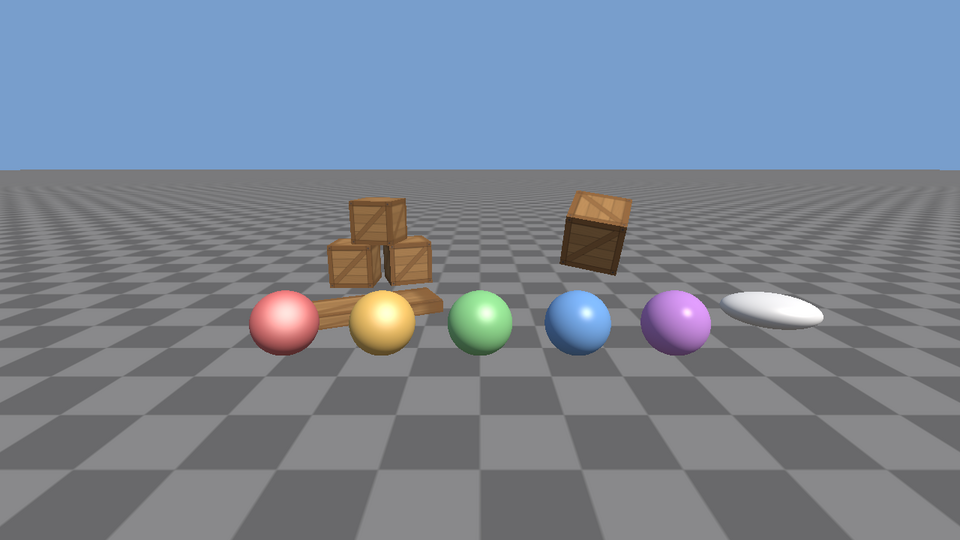

# Phase 2: Renderer basics

**Status: done.** It builds, the tests pass, and the sandbox runs (checked on Linux with Mesa's software OpenGL driver: GCC 13 Debug and Clang Release builds with warnings as errors, a GCC build under AddressSanitizer and UndefinedBehaviorSanitizer, all 9 test suites including the GPU suite, and the sandbox driven with real mouse and keyboard events).

> **Since Phase 3:** this scene is the `render_demo` program (`src/sandbox/render_demo.cpp`). The name `sandbox` now belongs to the Phase 3 entity scene. The commands below use the new name.



## Plan

**Goal:** draw a lit, textured 3D scene you can fly through, with every OpenGL object owned by a small C++ class that cleans up after itself.

| Piece | File | What it does |
|---|---|---|
| GL handles | `render/GLObject.h` | Move-only owner of one OpenGL name (buffer, texture, shader...). Deletes it in the destructor |
| Error checks | `render/GLCheck.h/.cpp` | `XE_GL_CHECK("what")` logs any `glGetError` codes in debug builds |
| Shaders | `render/Shader.h/.cpp`, `render/ShaderLog.h/.cpp` | Compile and link GLSL; errors come back as a value, with the failing source line quoted |
| Images | `render/Image.h/.cpp`, `render/StbImpl.cpp` | Load and save PNG/JPEG/TGA/BMP with stb; checkerboards; flipping |
| Textures | `render/Texture.h/.cpp` | Upload an image to the GPU: sRGB or linear, mipmaps, repeat, filtering |
| Meshes | `render/Mesh.h/.cpp`, `render/Primitives.h/.cpp` | Vertex and index buffers plus their layout; cube, plane and sphere made in code |
| Camera | `render/Camera.h/.cpp`, `render/FlyCameraController.h/.cpp` | Perspective camera from yaw and pitch; fly with the mouse and WASD |
| Renderer | `render/ForwardRenderer.h/.cpp` | `beginFrame / submit / endFrame`, one directional light, materials, stats, shader hot reload |
| Shaders | `assets/shaders/lit.vert`, `lit.frag` | Blinn-Phong lighting with a hemisphere ambient term, in linear color |
| Asset paths | `core/Paths.h/.cpp` | Finds the `assets/` folder (`XORDOR_ASSETS` overrides it) |
| Screenshots | `core/Screenshot.cpp` | Now writes PNG |
| Math | `core/Math.h/.cpp` | Adds `normalMatrix` |
| Sandbox | `sandbox/main.cpp` (now `render_demo.cpp`) | The 3D scene below. The Phase 1 demo lives on as `timestep_demo` |
| Tests | `tests/*_tests.cpp` | Primitives, camera, images, shader logs, plus GPU tests that check real pixels |

## Files that changed

```
native/
├── CMakeLists.txt                  + render sources, stb, XE_ASSET_DIR, XE_GPU_TESTS option
├── cmake/Dependencies.cmake        + stb (pinned commit)
├── .gitignore                      + screenshot.png
├── assets/                         new: runtime files, read from here (no copying)
│   ├── shaders/lit.vert, lit.frag
│   └── textures/crate.png          made by tools/make_textures.py
├── tools/make_textures.py          new: regenerates the sample texture (plain Python)
├── docs/phase-2.md, images/        new: this file
├── docs/phase-1.md                 program names updated
├── src/core/
│   ├── Math.h/.cpp                 + normalMatrix
│   ├── Paths.h/.cpp                new
│   └── Screenshot.h/.cpp           PPM -> PNG
├── src/render/                     new module
│   ├── GLObject.h  GLCheck.h/.cpp
│   ├── Shader.h/.cpp  ShaderLog.h/.cpp
│   ├── Image.h/.cpp  StbImpl.cpp  Texture.h/.cpp
│   ├── Mesh.h/.cpp  Primitives.h/.cpp
│   ├── Camera.h/.cpp  FlyCameraController.h/.cpp
│   └── ForwardRenderer.h/.cpp
├── src/sandbox/
│   ├── CMakeLists.txt              two programs now
│   ├── main.cpp                    new: the 3D scene
│   └── timestep_demo.cpp           was main.cpp (Phase 1)
└── tests/
    ├── CMakeLists.txt              + 4 suites, + gpu_tests program
    ├── camera_tests.cpp  image_tests.cpp  primitives_tests.cpp  shader_log_tests.cpp
    └── gpu_tests.cpp               draws offscreen and checks pixels
```

## Build and run

Same steps as [Phase 1](phase-1.md#build-and-run). The first configure now also clones **stb**. Shaders and textures are read straight from `native/assets/`, so there's nothing to copy, and an edited shader shows up without rebuilding.

### Windows (Visual Studio 2022, Developer PowerShell)

```powershell
cd xordor\native
cmake -S . -B build
cmake --build build --config Debug
ctest --test-dir build -C Debug
.\build\bin\Debug\render_demo.exe
```

### macOS

```bash
cd xordor/native
cmake -S . -B build
cmake --build build
ctest --test-dir build
./build/bin/render_demo
```

### Linux

```bash
cd xordor/native
cmake -S . -B build
cmake --build build -j
ctest --test-dir build
./build/bin/render_demo
```

### GPU tests

`gpu_tests` opens a hidden window and draws real frames, so `ctest` only runs it when you ask:

```bash
cmake -S . -B build -DXE_GPU_TESTS=ON
cmake --build build
ctest --test-dir build                       # on a desktop
xvfb-run -a ctest --test-dir build           # Linux with no screen (apt install xvfb)
```

### Render demo controls and options

| Input | Does |
|---|---|
| Hold right mouse + move | Look around (the cursor is hidden and captured while held) |
| Right mouse + W A S D, Q / E | Fly; down / up |
| Shift, scroll wheel | Four times faster; change the speed |
| J / L, I / K | Turn the sun around; raise or lower it |
| R | Reload shaders now (they also reload by themselves when saved) |
| F1 | Wireframe on / off |
| V, F12, H, Esc | Vsync, save `screenshot.png`, help, quit |

Command line: `render_demo --frames 300 --no-vsync --screenshot out.png` runs 300 frames and saves the last one. The window title shows FPS, draw calls, triangles and the camera speed. `timestep_demo` is the Phase 1 demo, unchanged.

## How it works

### 1. From numbers to pixels

```
CPU                                   GPU
MeshData {vertices, indices}
   │ Mesh(): glBufferData once  ──►   VBO (vertices)  EBO (indices)
   │                                  VAO (remembers both, and the layout:
   │                                       attribute 0 = position, 1 = normal, 2 = uv)
   │
ForwardRenderer::endFrame()
   │ per object: set uniforms   ──►   vertex shader (per vertex)
   │ glDrawElements                     world position = uModel * position
   │                                    gl_Position    = uViewProjection * world
   │                                        │
   │                                  rasterizer: which pixels each triangle covers;
   │                                  skips triangles facing away (culling)
   │                                        │
   │                                  fragment shader (per pixel): lighting -> color
   │                                        │
   │                                  depth test: keep it only if nearer than what's there
   ▼                                        ▼
                                      framebuffer ──► swapBuffers ──► screen
```

The vertex data goes to the GPU **once**, when the `Mesh` is created. Every frame after that the CPU only sends a few matrices and colors (uniforms) and says "draw mesh N". That split is the reason GPUs are fast: the data doesn't cross the bus again.

A `Vertex` is 8 floats (32 bytes): position, normal, uv, side by side. `glVertexAttribPointer` tells the GPU where each part starts (`offsetof`) and how far apart vertices are (`sizeof(Vertex)`). A `static_assert` checks the struct has no padding, because the GPU reads raw bytes and would silently read garbage otherwise.

### 2. Spaces and matrices

```
object space ──model──► world space ──view──► camera space ──projection──► clip space ──÷w──► screen
 (the mesh as made)     (where it is)        (camera at 0,0,0           (a box from -1 to +1:
                                              looking down -Z)           what's inside is visible)
```

- **Model** = `composeTRS(position, rotation, scale)`, from Phase 1.
- **View** is the inverse of the camera's own placement: it moves the whole world so the camera ends up at the origin, looking down -Z.
- **Projection** squeezes the camera's view pyramid (the *frustum*) into a box. Things further away get divided by a bigger `w`, which is what makes them look smaller.

The camera stores only `yaw` and `pitch`, not a full rotation, because people think "turn left, look up". `forward()` turns those two angles into a direction. Pitch stops at ±89°: straight up, forward and world-up are parallel, `lookAt` can't tell which way is right, and the image spins.

### 3. Owning OpenGL objects: RAII

OpenGL hands out plain numbers (`GLuint`) and expects you to call the matching `glDelete*` later. That's the same problem as `new`/`delete`, so it gets the same answer:

```cpp
template <void (*Delete)(GLuint)> class GLObject;   // owns one name; destructor calls Delete
using GLBuffer  = GLObject<deleteBuffer>;            // glDeleteBuffers
using GLTexture = GLObject<deleteTexture>;           // glDeleteTextures ...
```

It can be **moved but not copied**. A copy would mean two owners deleting the same name, and the second delete could destroy an unrelated object that reused the number. `Shader`, `Texture` and `Mesh` hold `GLObject`s, so they need no destructor of their own.

One rule RAII can't enforce: **GPU objects must die before the OpenGL context does.** In the sandbox that comes free from C++'s destruction order. Members of `Sandbox` are destroyed before its base class `Application`, which owns the window and the context. The GPU test fixture declares its `Window` first for the same reason.

### 4. Culling and depth

- **Winding.** Every triangle lists its corners counter-clockwise *as seen from outside*. After projection, the GPU checks the on-screen order: clockwise means the triangle faces away, and `glCullFace(GL_BACK)` skips it. On a closed shape that's half the triangles for free. Get one face's order wrong and that face vanishes, so `primitives_tests.cpp` checks every triangle's winding against its normals.
- **Depth buffer.** Each pixel also stores how far away its surface is. A new fragment is kept only if it's nearer (`GL_LESS`), so the draw order doesn't matter for solid objects. The GPU test draws a near red cube and a far green cube in both orders and expects red both times. The depth buffer must be cleared every frame, or last frame's surfaces would hide this frame's.

### 5. Lighting: Blinn-Phong plus a hemisphere

```
            N (surface normal)
            │      H = normalize(L + V)
       L    │    ╱
 sun ───╲   │  ╱     V
         ╲  │╱    ╱  eye
──────────────●──────────── surface
```

`lit.frag` adds three terms:

| Term | Formula | Meaning |
|---|---|---|
| Diffuse | `max(dot(N, L), 0)` | Light hitting head-on is brightest; at a grazing angle the same light spreads over more surface |
| Specular | `pow(max(dot(N, H), 0), shininess) * specular` | A highlight where the surface would mirror the sun into the eye. A bigger exponent gives a smaller, sharper spot (the five spheres go from 8 to 128) |
| Ambient | `mix(groundColor, skyColor, N.y * 0.5 + 0.5)` | Light that bounced around. Up-facing surfaces get sky blue, down-facing ones get ground brown. A cheap stand-in for real indirect light |

`color = albedo * (ambient + light * diffuse) + light * specular`. The highlight isn't tinted by the albedo, which is why it looks like a shiny coat rather than colored paint.

**The normal matrix.** Normals can't always use the model matrix. Stretch a sphere along X and, using the model matrix, its slanted normals stretch along X too: they tilt *toward* the stretched axis, while the real surface now leans *away* from it. The inverse transpose of the model matrix's 3×3 part keeps them perpendicular to the surface (`Math::normalMatrix`; `math_tests.cpp` checks this with a 45° slope). The white egg in the sandbox, a sphere scaled to (1.6, 0.6, 1), is this case. Try replacing `uNormalMatrix * aNormal` with `mat3(uModel) * aNormal` while the sandbox runs: the egg's shading and highlight shift to the wrong place, but the crates and the flat plank look unchanged. Their normals point straight along the box's axes, so scaling changes only their length, and the shader normalizes that away.

### 6. Color spaces: why there's a `pow(color, 1/2.2)` at the end

Image files and monitors store colors **gamma-encoded** (sRGB): the byte value 128 isn't half as bright as 255, it's about a fifth. Light adds up in **linear** values. So:

```
crate.png (sRGB bytes) ── GL_SRGB8_ALPHA8: the GPU decodes to linear when sampling ──┐
                                                                                     ▼
                                                      lighting math, all linear (adds and multiplies)
                                                                                     │
                                       pow(color, 1/2.2): encode for the monitor ◄───┘
```

If you skip the decode, textures look washed out once lit. If you skip the encode, everything looks too dark with harsh falloff. Normal maps and other data textures must use `ColorSpace::Linear`, because their bytes aren't colors. The clear color skips the shader, so it's given in display (sRGB) values, like a color picker.

### 7. Textures

`Texture(image)` flips the rows (image files start at the top, OpenGL's texture row 0 is the bottom), uploads, and builds **mipmaps**: half-size, quarter-size... copies down to 1×1. Far away, one screen pixel covers many texture pixels. Sampling one of them at random would shimmer, so the GPU reads a smaller, pre-averaged copy instead (*trilinear* filtering blends between two mip levels). Look at the far checkerboard in the sandbox: smooth gray, not noise.

A material with no texture uses a 1×1 **white** texture. White × color = color, so the shader has no "if textured" branch.

### 8. The renderer

```
beginFrame(camera, light, clear)   clear color + depth, set state, empty the queue
submit(mesh, material, model) ×N   only records {mesh, material, matrix}
endFrame()                         per-frame uniforms once, then per item:
                                   bind texture, material + matrix uniforms, draw
```

Recording first and drawing later costs almost nothing now. It's the hook for later work: sorting by texture to save binds, skipping objects outside the frustum, or drawing transparent things last (see the TODOs in `ForwardRenderer.h`).

`Shader::set("uModel", m)` looks up the uniform's location once and caches it. If a name isn't in the shader (misspelled, or removed by the compiler because nothing uses it), it logs a warning once instead of quietly doing nothing.

### 9. Shader errors and hot reload

Driver error logs are short on context: `0:46(74): error: 'specularTypo' undeclared`. `annotateShaderLog` finds the line number (Mesa, NVIDIA and Apple each format it differently, see `shader_log_tests.cpp`) and prints the source line under it:

```
lit (fragment shader) failed to compile:
0:46(74): error: `specularTypo' undeclared
    46 |     vec3 color = albedo * (ambient + uLightColor * diffuse) + uLightColor * specularTypo;
```

`Shader::fromSource` returns `std::optional<Shader>` instead of throwing, because a broken shader during editing is normal, not exceptional. The renderer checks the files' modification time twice a second. When one changes it compiles the new version and swaps it in only if it compiled; otherwise the last good shader keeps drawing. (Only the first load throws, since nothing can be drawn without any shader.)

### 10. Testing pixels

`gpu_tests.cpp` renders into an **offscreen framebuffer** (a color and a depth buffer that aren't the window), reads pixels back with `glReadPixels`, and checks things you can state plainly: the clear color fills an empty frame, a cube covers the center but not the corners, the lit side of a sphere is brighter, nearer wins, a blue texture gives blue, a cube seen from inside is culled. Checking a few meaningful pixels instead of comparing whole images keeps the tests stable across GPUs and drivers.

## Exercises

1. **A point light.** Add `PointLight { position, color, range }` to the renderer (start with one) and add its contribution in `lit.frag`. `L` becomes `normalize(lightPos - worldPos)`, and brightness falls off with distance, for example `1 / (1 + d*d)` faded to 0 at `range`. Hang a warm light above the crates and fly around it. Why does a point light need the fragment's world position but a sun doesn't?
2. **Distance fog to hide the horizon.** Blend the final color toward the sky color as distance from the camera grows: `mix(color, fogColor, 1 - exp(-distance * density))`. The sky color is given in display space but your fog math runs in linear space before the gamma line. Convert it with `pow(sky, 2.2)` and check the far ground melts exactly into the sky. Try it without the conversion and explain the visible band.
3. **Measure, then optimize.** Add `textureBinds` to `RenderStats`, count binds in `endFrame`, and show it in the title. Then sort the queue by texture before drawing and skip a bind when the texture didn't change. Spawn 2,000 crates and spheres in a grid and compare FPS and binds before and after. Which helped more, and is it worth it at this scene size?

## Known limitations and what comes next

- **One light, no shadows.** One directional light only. Point and spot lights are exercise 1; shadow mapping is a possible later addition.
- **One shader and material model.** Everything uses `lit`. There is no transparency, normal mapping, or PBR (metal/roughness) yet. Blinn-Phong was chosen because each term can be explained in a sentence.
- **Gamma is the 2.2 approximation** done in the shader, rather than an sRGB framebuffer (`GL_FRAMEBUFFER_SRGB`). It's simple and visible, but slightly off from true sRGB in the darkest tones.
- **No sorting or culling.** Every submitted object is drawn in order. The TODOs mark where sorting and frustum culling go. Draw calls aren't the bottleneck at this scale.
- **Objects are hand-made `Prop` structs** in the sandbox. Phase 3 replaces them with entities, `Transform` and `MeshRenderer` components, and parent-child transforms.
- **Assets are loaded by path** from the source folder. GUIDs, a texture cache, model import (OBJ, glTF) and shipping assets next to the game come in Phase 4.
- **No anisotropic filtering** (marked TODO in `Texture.cpp`), so the floor blurs at grazing angles.
- **Mesa leak report.** Under LeakSanitizer, Mesa's software driver reports a few 56-byte "indirect leaks" allocated inside the driver during the first draw. None come from engine code.
- **Tested on Linux with Mesa's llvmpipe** (OpenGL 4.5 in software). The context asked for is 4.1 core, which macOS and every desktop GPU since 2010 support, but the Windows and macOS steps weren't run here.

**Next: [Phase 3, scene graph and entity-component system](phase-3.md).** A `Scene` holding entities, with `Transform` (including parent and child), `MeshRenderer`, `Camera`, `Light` and `Collider` components. The renderer will draw whatever the scene holds, and the sandbox's hand-made props move into it.
