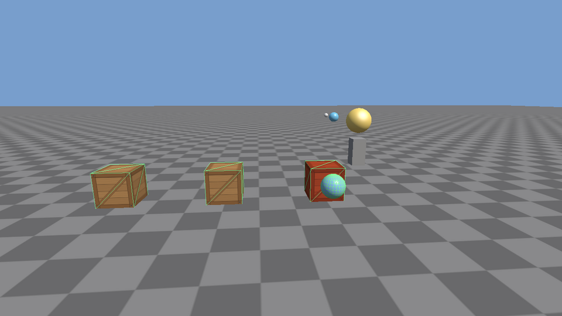

# Phase 3: Scene graph and entity-component system

**Status: done.** It builds, the tests pass, and the sandbox runs (checked on Linux with Mesa's software OpenGL driver: GCC 13 Debug and Clang Release builds with warnings as errors, a GCC build under AddressSanitizer and UndefinedBehaviorSanitizer, all 12 test suites including the GPU suite, and the sandbox driven with real keyboard and mouse events, including spawning, deleting and reparenting entities under the sanitizers).

> **Since Phase 4:** `MeshRenderer` stores asset ids instead of pointers, and the sandbox loads this same scene from `assets/scenes/sandbox.scene.json`, with the same controls plus F5/F9 to save and load. The ECS, hierarchy and collision code below is unchanged.



## Plan

**Goal:** stop hand-placing objects in the app. Everything becomes an *entity* with *components*, entities can be parented to each other, and the renderer draws whatever the scene contains.

| Piece | File | What it does |
|---|---|---|
| Entity handles | `scene/Entity.h` | An index plus a generation: detects handles to destroyed entities |
| Component storage | `scene/ComponentPool.h` | One packed array per component type (a sparse set) |
| Registry | `scene/Registry.h/.cpp` | Create and destroy entities; add, get, remove components; `each<A, B>()` queries |
| Components | `scene/Components.h` | `Name`, `Transform`, `Hierarchy`, `MeshRenderer`, `CameraComponent`, `LightComponent`, `Collider` |
| Scene | `scene/Scene.h/.cpp` | Parent-child hierarchy, world matrices, interpolation, finding cameras |
| Shapes | `core/Geometry.h/.cpp` | Boxes and spheres, overlap tests, fitting a box around a rotated box |
| Collision queries | `scene/Collision.h/.cpp` | Which colliders overlap; colliders in world space |
| Scene renderer | `scene/SceneRenderer.h/.cpp` | Camera entity → view, light entity → sun, mesh entities → draw calls; collider wireframes |
| Renderer changes | `render/Camera.h`, `ForwardRenderer.h` | `CameraView` (a camera is anything with a view and projection), per-material wireframe |
| Math | `core/Math.h/.cpp` | `decomposeTRS`, the reverse of `composeTRS` |
| Sandbox | `sandbox/main.cpp` | The entity scene below. The Phase 2 scene lives on as `render_demo` |
| Tests | `tests/ecs_tests.cpp`, `scene_tests.cpp`, `geometry_tests.cpp`, + math and GPU | Handles, pools, queries, hierarchy, interpolation, cameras, collisions, rendering a scene |

## Files that changed

```
native/
├── ARCHITECTURE.md                 component and class names updated
├── CMakeLists.txt                  + scene sources, core/Geometry.cpp
├── docs/phase-3.md, images/        new: this file
├── docs/phase-2.md                 program name updated (render_demo)
├── src/core/
│   ├── Geometry.h/.cpp             new: Aabb, Sphere, overlaps, transformAabb
│   └── Math.h/.cpp                 + decomposeTRS
├── src/render/
│   ├── Camera.h/.cpp               + CameraView, toView(), rotation()
│   └── ForwardRenderer.h/.cpp      takes a CameraView; Material::wireframe
├── src/scene/                      new module
│   ├── Entity.h  ComponentPool.h  Registry.h/.cpp
│   ├── Components.h  Scene.h/.cpp
│   ├── Collision.h/.cpp
│   └── SceneRenderer.h/.cpp
├── src/sandbox/
│   ├── CMakeLists.txt              three programs now
│   ├── main.cpp                    new: the entity scene
│   └── render_demo.cpp             was main.cpp (Phase 2)
└── tests/
    ├── CMakeLists.txt              + ecs, geometry, scene suites
    ├── ecs_tests.cpp  geometry_tests.cpp  scene_tests.cpp      new
    ├── math_tests.cpp              + decomposeTRS
    └── gpu_tests.cpp               + drawing a scene through a camera entity
```

## Build and run

Nothing new to install. Same commands as before:

| | Commands |
|---|---|
| Windows (Developer PowerShell for VS 2022) | `cmake -S . -B build` · `cmake --build build --config Debug` · `ctest --test-dir build -C Debug` · `.\build\bin\Debug\sandbox.exe` |
| macOS | `cmake -S . -B build` · `cmake --build build` · `ctest --test-dir build` · `./build/bin/sandbox` |
| Linux | `cmake -S . -B build` · `cmake --build build -j` · `ctest --test-dir build` · `./build/bin/sandbox` |

GPU tests: configure with `-DXE_GPU_TESTS=ON` (and on a Linux machine without a screen, run `xvfb-run -a ctest --test-dir build`). The older demos are `render_demo` (Phase 2) and `timestep_demo` (Phase 1).

### Sandbox controls

| Input | Does |
|---|---|
| Right mouse + move, WASD, Q / E, Shift, scroll | Fly (as in Phase 2) |
| J / L, I / K | Turn the sun entity; raise or lower it |
| C | Show colliders as green wireframes |
| P | Pause the simulation (rendering continues) |
| B | Detach the planet from the orrery / attach it again (keeps its world position) |
| N, Backspace, Delete | Add a crate in front of you; remove the newest; remove the whole "Spawned" group |
| Tab | Print the scene hierarchy to the log |
| R, F1, V, F12, H, Esc | Reload shaders, wireframe, vsync, screenshot, help, quit |

Options: `--frames N`, `--no-vsync`, `--screenshot out.png`. The title shows FPS, entity count, draw calls, and how many crates the ball touches.

## How it works

### 1. Entities are ids, components are data, systems are loops

```
Entity 7  ──┬── Name        { "Planet" }
            ├── Transform   { position (2.4, 0, 0), rotation, scale 0.5 }
            ├── Hierarchy   { parent: Orrery Arm, children: [Moon] }
            ├── MeshRenderer{ sphere, blue material }
            └── Spin        { axis Y, 120 deg/s }       <- defined in the sandbox
```

There is no `Planet` class. A planet is whatever has these components, and the behavior lives in **systems**: functions that loop over every entity with a certain set of components.

```cpp
registry.each<Spin, Transform>([&](Entity, Spin& spin, Transform& t) {
    t.rotation = glm::angleAxis(radians(spin.degreesPerSecond) * dt, spin.axis) * t.rotation;
});
```

Why not inheritance (`Planet : SpinningThing : MeshObject : GameObject`)? Because real games mix features freely. A spinning, collidable, scripted crate would need a class for every combination, while here it just has three components. Systems also touch only the data they need, all packed together, which is fast. The sandbox's `Spin`, `Patrol` and `HitHighlight` are ordinary structs that the engine has never heard of: any struct can be a component.

### 2. Storing components: the sparse set

```
            entity index:  0   1   2   3   4   5
ComponentPool<Collider>
   sparse_               [ -   2   -   0   -   1 ]   entity index -> slot   (- = none)
   entities_             [ e3  e5  e1 ]               who owns each slot
   components_           [ C   C   C  ]               the data, no gaps
```

- `has / get / add / remove` are a couple of array lookups: constant time.
- `each` walks `components_` front to back. The CPU fetches memory in 64-byte lines, so packed data means fewer trips to memory than chasing pointers to objects scattered on the heap.
- **remove** moves the *last* element into the hole and fixes one `sparse_` entry ("swap and pop"). That's why order isn't guaranteed, and why `Scene::roots()` sorts before printing.
- **The one rule:** a `T&` from `get` or `add` is valid only until the next `add` or `remove` of type `T`, because growing the vector can move everything. Store `Entity` handles, never component pointers. `ecs_tests.cpp` covers removing from the middle, a thousand entities with reused slots, and changing the registry inside `each`. `each` loops over a copy of the entity list so that it stays safe.

Each type gets its pool by a small number from `componentTypeId<T>()`: a function-local `static` that is initialized once per type, the first time it's asked.

### 3. Entity handles and generations

```
create()  -> {index 4, gen 0}     destroy it: slot 4's generation becomes 1, slot goes on the free list
create()  -> {index 4, gen 1}     the slot is reused
old handle {index 4, gen 0}: alive()? 4's generation is 1, not 0 -> no. has<T>()? no.
```

Without the generation, a gun that remembered "my target is entity 4" would start shooting at whatever new entity got slot 4. With it, the stale handle simply stops working, which you can check with `scene.isAlive(target)`. It's a weak reference without any allocation or reference counting.

### 4. The hierarchy and world matrices

Each `Transform` is **local**: relative to its parent. The world matrix multiplies up the chain:

```
Orrery Arm   world = T(5.5, 2, -5) * R(spin)
└─ Planet    world = Arm.world    * T(2.4, 0, 0) * R(own spin) * S(0.5)
   └─ Moon   world = Planet.world * T(1.8, 0, 0) * S(0.4)
```

So the moon is 1.8 *planet units* out: 1.8 × 0.5 = 0.9 m. Spin the arm and everything below it swings around. Spin the planet and the moon orbits it. Nothing ever moves the moon directly.

`Hierarchy` keeps both directions, parent and children, so it can walk up (world matrix) and down (destroy a subtree, print the tree). The two sides must agree, so only `Scene::setParent` changes them. It also refuses loops (A under its own grandchild), because `worldMatrix` follows parents until it reaches the top, and a loop would never end.

`worldMatrix(e)` is computed on demand by walking up the parents, so it can never be stale. That's a few matrix multiplies per level, which is fine for hundreds of entities. Caching with "dirty" flags is the TODO for when it isn't.

### 5. Reparenting without jumping (`keepWorldTransform`)

Press B in the sandbox. The planet leaves the arm but stays exactly where it was:

```
before:   world = Arm.world * local
after:    world = local'                       (no parent now)
so:       local' = inverse(newParent.world) * world        (newParent = identity here)
```

`setParent` measures the world matrix first, changes the parent, then solves for the new local matrix and splits it back into position, rotation and scale (`Math::decomposeTRS`). With `keepWorldTransform = false` the local numbers stay and the object jumps to the same offset from its new parent. Both are useful: dropping a carried item wants "keep world", attaching a hat to a head wants "keep local".

One honest limitation: a non-uniformly scaled parent with a rotated child creates **shear**, which no position/rotation/scale can describe. `decomposeTRS` then returns the nearest fit, and the child changes shape slightly. Unity and Unreal have the same issue.

### 6. Interpolation, now for everything

Phase 1 kept `previous` positions by hand for one ball. Now every `Transform` keeps them:

```
onFixedUpdate:  scene.beginFixedStep()      previous* = current, for every transform
                ...systems move things...    current changes
onRender:       interpolatedWorldMatrix(e, alpha)   blends previous -> current at every level
```

Blending happens per level (local position, rotation and scale, then up the chain), so the moon follows a curved path between steps. Blending its final world positions would cut straight across the curve.

Two cases need care:
- **Things moved per frame** rather than per fixed step, like the camera following the mouse, call `resetInterpolation()` after moving. Otherwise they'd be blended back toward where they were at the last fixed step, and lag.
- **Newly created entities** have no previous values yet (`hasPrevious = false`), so they're drawn where they are. Without that flag, a crate spawned mid-frame would slide in from (0, 0, 0). A test checks this.

### 7. The scene renderer: the only place scene meets renderer

```
Scene ──► SceneRenderer ──► ForwardRenderer ──► OpenGL
          primary CameraComponent + Transform  ->  CameraView (looks down -Z, scale ignored)
          first LightComponent + Transform     ->  DirectionalLight (shines down -Z)
          each visible MeshRenderer            ->  submit(mesh, material, interpolated world)
          (C) each Collider                    ->  wireframe cube / sphere
```

`render/` still knows nothing about entities. To make that possible, the renderer now takes a `CameraView` (view matrix, projection, position) instead of the fly camera class. Any source of those three things is a camera. Missing cameras or lights are logged **once**, not every frame, and with no camera the screen is still cleared.

Camera and light directions use the entity's −Z axis, read straight from the world matrix: column 2 is where the entity's Z axis points. The camera normalizes the axes it reads, so a scaled parent can't stretch the picture.

### 8. Colliders and overlap queries

```cpp
std::vector<Entity> hits = overlapping(scene, ball);   // every collider touching the ball
auto pairs = findOverlaps(scene);                      // every touching pair, each once
```

Each `Collider` is turned into a world-space shape: spheres move and grow with the largest scale axis, and boxes become the **axis-aligned box around** the rotated box (Arvo's method in `transformAabb`). The tests are small:

| Pair | Overlap when |
|---|---|
| box / box | their ranges overlap on x **and** y **and** z |
| sphere / sphere | distance between centers ≤ sum of radii (compared squared, no square root) |
| sphere / box | the box's nearest point to the center (clamp) is within the radius |

Collision runs in the fixed step on *current* positions, so results don't depend on frame rate. The wireframes drawn with C show the same current shapes, which can sit a fraction of a step ahead of the blended mesh. They're drawn 2% larger, because two surfaces at exactly the same depth flicker (*z-fighting*) and the lines turned to dashes.

## Exercises

1. **A bobbing system.** Add a `Bob { float height; float speed; float time; }` component that moves an entity up and down with `sin`. Put it on the star and on one crate. Then make the orrery arm bob too: what happens to the planet and moon, and why didn't you have to change anything for them? (Hint: you'll need the starting height. Store it in the component.)
2. **Collision events.** `hitHighlightSystem` recomputes overlaps every step. Keep last step's set of touching pairs and compare it with this step's to log `"Ball started touching Crate 2"` and `"...stopped touching..."` exactly once each. This "enter / exit" bookkeeping is what Phase 6's event system builds on. Which data structure makes "was this pair touching last step?" fast?
3. **Find the stale handle bug.** Store the newest spawned crate's `Entity` in a member, press Delete (which destroys the whole group), then press a new key that changes that crate's color. Use `scene.isAlive()` so it logs a clear message instead. Then explain, using generations, why `get<MeshRenderer>(staleHandle)` asserts instead of silently recoloring a different crate that reused the slot.

## Known limitations and what comes next

- **No collision response.** Overlaps are detected, not resolved: the ball goes through crates. Pushing apart, velocities and triggers are Phase 6.
- **Rotated boxes are approximated** by the axis-aligned box around them, which is larger than the box (41% wider at 45°). Oriented boxes are a TODO.
- **Collision checks every pair** (O(n²)), fine for hundreds of colliders. A broad phase (grid, sort-and-sweep) is a TODO.
- **World matrices aren't cached.** They're recomputed on every query by walking up the parents. Dirty-flag caching is a TODO.
- **Meshes and textures are raw pointers** in `MeshRenderer`; the app owns them. Phase 4 replaces them with asset ids, so the asset system owns them and scenes can be saved to JSON.
- **Shear can't be decomposed** (see section 5).
- **One light, one camera at a time**, as the renderer supports.
- **Not thread-safe.** Entities and components are created on the main thread only (noted at `nextComponentTypeId`).
- Tested on Linux with Mesa only; the Windows and macOS commands follow the same CMake flow but weren't run here.

**Next: [Phase 4, assets](phase-4.md).** GUIDs in `.meta` files, OBJ and glTF mesh import, a texture cache, and saving and loading scenes as readable JSON, so `MeshRenderer` stores asset ids instead of pointers.
