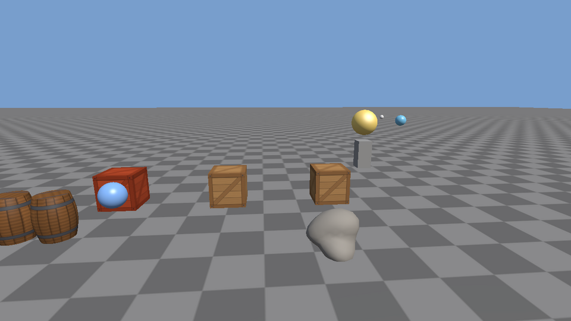

# Phase 4: Assets

**Status: done.** It builds, the tests pass, and the sandbox runs (checked on Linux with Mesa's software OpenGL driver: GCC 13 Debug and Clang Release builds with warnings as errors, a GCC build under AddressSanitizer and UndefinedBehaviorSanitizer, all 15 test suites with 128 unit tests and 9 GPU tests, and the sandbox driven with real key presses through save, hand-edit-and-reload, and loading a broken file, also under the sanitizers).



## Plan

**Goal:** everything in a scene comes from files and goes back into a file. Assets get permanent ids, models load from OBJ and glTF, each asset is loaded once and shared, and scenes are saved as JSON that people can read and edit.

| Piece | File | What it does |
|---|---|---|
| Asset ids | `core/AssetId.h/.cpp` | 128-bit random GUIDs, text form, fixed ids for the built-in cube / plane / sphere |
| Registry | `assets/AssetRegistry.h/.cpp` | Scans the assets folder; reads or creates a `.meta` file (id + import settings) beside every asset |
| Caches | `assets/AssetManager.h/.cpp` | Loads a mesh or texture by id the first time it's asked for, then shares it |
| OBJ import | `assets/ObjImport.cpp` | Our own reader for the OBJ text format |
| glTF import | `assets/GltfImport.cpp`, `CgltfImpl.cpp` | glTF 2.0 through cgltf: node transforms, accessors, uv flip |
| Scenes as JSON | `assets/SceneSerializer.h/.cpp`, `JsonUtil.h/.cpp` | Save and load scenes; apps register their own components; compact readable output |
| Scene side | `scene/RenderAssets.h`, `Components.h`, `SceneRenderer` | `MeshRenderer` holds asset ids; an interface lets the scene ask for meshes without depending on `assets/` |
| Math | `core/Math.h/.cpp` | `eulerDegreesFromQuat`, for rotations people can read |
| Sample assets | `tools/make_models.py`, `make_textures.py` | A barrel (OBJ), a rock (glTF), floor and barrel textures |
| Sandbox | `sandbox/main.cpp` | Loads `assets/scenes/sandbox.scene.json`; F5 saves, F9 reloads |
| Tests | `tests/asset_tests.cpp`, `model_tests.cpp`, `serializer_tests.cpp`, + math and GPU | Ids, .meta handling, importers, round trips, bad files |

**Why not Assimp?** The plan listed it, but Phase 4 needs two formats. Assimp reads 40+ formats, is around a million lines, and adds minutes to every clean build. OBJ is simple text, so reading it ourselves (one short file) shows exactly what a mesh file contains. glTF stores typed binary buffers, so a small single-header library (cgltf) handles that bookkeeping. Assimp can still be added later behind the same `importModel()` call if more formats are needed.

## Files that changed

```
native/
├── ARCHITECTURE.md  README.md      asset module, libraries
├── CMakeLists.txt                  + assets sources, nlohmann_json (public), cgltf (private)
├── cmake/Dependencies.cmake        + nlohmann/json v3.11.3, cgltf v1.14
├── assets/
│   ├── models/barrel.obj  rock.gltf          new (+ .meta)
│   ├── textures/checker.png  barrel.png      new (+ .meta); crate.png gets a .meta
│   └── scenes/sandbox.scene.json             new (+ .meta): the sandbox scene
├── tools/make_models.py            new;  make_textures.py: + checker, barrel
├── docs/phase-4.md, images/        new: this file;  phase-3.md: note about the sandbox
├── src/core/
│   ├── AssetId.h/.cpp              new
│   └── Math.h/.cpp                 + eulerDegreesFromQuat
├── src/render/Mesh.h               Vertex fields start at zero (see "a bug worth knowing")
├── src/assets/                     new module
│   ├── AssetRegistry.h/.cpp  AssetManager.h/.cpp
│   ├── ModelImport.h  ObjImport.cpp  GltfImport.cpp  CgltfImpl.cpp
│   └── SceneSerializer.h/.cpp  JsonUtil.h/.cpp
├── src/scene/
│   ├── RenderAssets.h              new: the interface the asset manager implements
│   ├── Components.h                MeshRenderer: asset ids + MeshMaterial
│   └── SceneRenderer.h/.cpp        resolves ids through RenderAssets
├── src/sandbox/main.cpp            scene from a file; F5 / F9; registers its components
└── tests/
    ├── asset_tests.cpp  model_tests.cpp  serializer_tests.cpp      new
    └── math_tests.cpp  gpu_tests.cpp  CMakeLists.txt               updated
```

## Build and run

Same commands as before. The first configure also clones nlohmann/json and cgltf.

| | Commands |
|---|---|
| Windows (Developer PowerShell for VS 2022) | `cmake -S . -B build` · `cmake --build build --config Debug` · `ctest --test-dir build -C Debug` · `.\build\bin\Debug\sandbox.exe` |
| macOS | `cmake -S . -B build` · `cmake --build build` · `ctest --test-dir build` · `./build/bin/sandbox` |
| Linux | `cmake -S . -B build` · `cmake --build build -j` · `ctest --test-dir build` · `./build/bin/sandbox` |

GPU tests: configure with `-DXE_GPU_TESTS=ON` (on a Linux machine without a screen: `xvfb-run -a ctest --test-dir build`). To regenerate the sample files: `python3 tools/make_textures.py` and `python3 tools/make_models.py`. Their `.meta` files stay, so their ids don't change.

### Sandbox controls

| Input | Does |
|---|---|
| F5 / F9 | Save the scene to `assets/scenes/sandbox.scene.json` / load it back |
| Tab / A | Print the hierarchy (with each mesh's file) / the asset list with ids |
| C, P, B | Colliders, pause, detach or attach the planet |
| N, Backspace, Delete | Add a crate, remove the newest, remove all added crates |
| Right mouse + WASD / QE, J/L/I/K | Fly; move the sun |
| R, F1, V, F12, H, Esc | Reload shaders, wireframe, vsync, screenshot, help, quit |

Options: `--rebuild-scene` ignores the file, builds the default scene in code, and saves it. Also `--frames N`, `--no-vsync`, `--screenshot out.png`. Set `XORDOR_ASSETS=/some/folder` to work on a copy of the assets.

Try this: start the sandbox, open the scene file in an editor, change the `"baseColor"` of `"Ball"`, save, and press F9. Then delete a comma and press F9 again: the log names the line, and the scene on screen doesn't change.

## How it works

### 1. Ids instead of paths, and `.meta` files

```
assets/textures/crate.png
assets/textures/crate.png.meta   {
                                   "guid": "f00b40e2-f426-49c0-a567-303059571361",
                                   "type": "texture",
                                   "settings": { "colorSpace": "srgb", "mipmaps": true, ... }
                                 }
scene file:   "albedo": { "id": "f00b40e2-...", "path": "textures/crate.png" }
```

If scenes stored paths, renaming `crate.png` would silently break every scene that uses it. So each asset gets a **random 128-bit id** the first time the registry sees it, written to a `.meta` file beside it. Scenes store the id; the path in the scene file is only a hint for people reading it. Rename or move a file *together with its .meta* and nothing breaks.

Random ids need no central counter, so two people adding files on two machines never pick the same number (2¹²² possibilities). The cube, plane and sphere made in code get small fixed ids (`...0001`, `...0002`, `...0003`), which random version-4 ids can never equal.

The registry also handles the usual accidents. A copied `.meta` (two files, one id) gets a new id and a warning. A `.meta` whose file is gone is reported. A **broken `.meta` is reported and left alone**: rewriting it would hand out a new id and break every scene that used the old one. `.meta` files are commit-worthy source files, like the assets themselves; a test checks that every shipped asset has one.

### 2. Load once, share everywhere

```
MeshRenderer { mesh: id }  ──►  SceneRenderer ──► RenderAssets::mesh(id)
                                                       │  (interface in scene/)
                                                       ▼
                                 AssetManager:  cache hit?  ── yes ──► same Mesh*
                                                    │ no
                                                    ▼
                         registry: id -> "models/barrel.obj" + settings
                         importModel() -> MeshData -> Mesh (GPU)  -> cache
```

Three crates share one cube and one texture on the GPU. A failed load is cached too, as an empty entry, so a missing file is logged once instead of 60 times a second.

**Dependency inversion.** The scene renderer needs meshes, but `scene/` comes *before* `assets/` in the module order, since assets must know about scenes to save them. So `scene/` declares a small interface, `RenderAssets` with `mesh(id)` and `texture(id)`, and `assets/AssetManager` implements it. The GPU test plugs in a fake that hands out one mesh, with no files at all.

### 3. Reading OBJ: one vertex per unique triple

```
v  0 0 0        positions[0]        f 1/1/1 2/2/1 3/3/1
v  1 0 0        positions[1]          │  each corner = position / uv / normal index
vt 0 0          uvs[0]                ▼
vn 0 0 1        normals[0]          (0,0,0) (1,1,0) (2,2,0) -> Vertex 0, 1, 2
```

OBJ keeps separate lists, but the GPU wants one array of complete vertices. Each *distinct* `position/uv/normal` triple becomes one `Vertex`, and repeats reuse it through a map. A cube corner used by three faces with three different normals becomes three vertices, which is exactly what flat-shaded edges need. Faces with more corners become a fan of triangles (0-1-2, 0-2-3...). Negative indices count from the end. Lines we don't use (`mtllib`, `usemtl`, `o`, `g`, `s`) are counted and reported in one log line, not silently dropped. Errors name the file and line: `bad.obj, line 3: index 3 in "3" points past the 2 entries read so far`.

**Missing normals** are computed: each triangle adds its cross product (length = twice its area) to its three vertices, then each sum is normalized. Shared vertices come out smooth and big faces count more. The rock is stored without normals and gets them this way.

### 4. Reading glTF: nodes, accessors, two conventions

A glTF file is a tree of nodes. A node can have a mesh, and a mesh's primitives point at **accessors** ("162 VEC3 floats at byte 1920 of buffer 0"). cgltf parses that, and `cgltf_accessor_read_float` reads element *i* whatever the storage type. We walk the tree, apply each node's world matrix (positions with the matrix, normals with the normal matrix), and append everything to one mesh. The rock's node squashes it to 0.7 height, and a test checks the importer applied that.

Two conventions differ from ours. glTF's uv (0,0) is the image's *top*-left, so `v = 1 - v`. A mirrored node (negative scale) turns triangles inside out, so two corners are swapped to keep them facing outward.

### 5. A bug worth knowing: uninitialized GLM vectors

The first glTF test failed: some rock normals pointed the wrong way, but only in C++ (the same math in Python was fine). The cause was `Vertex v;`. **GLM vectors aren't zeroed by default**, like plain `float`s, so a file without normals left whatever bytes were in memory. Those looked like "normals already set", and the normal computation skipped them. The OBJ reader never hit this because it sets every field. The fix is `Vec3 normal{0.0f};` in `Vertex`. AddressSanitizer doesn't catch reads of uninitialized memory, which is a different tool's job (MemorySanitizer), so tests that check *results* matter.

### 6. Scene files

```json
{
  "format": "xordor-scene", "version": 1,
  "environment": { "clearColor": [0.47, 0.62, 0.8], ... },
  "entities": [
    { "id": 4, "name": "Crate Row",
      "transform": { "position": [0.0, 0.0, 0.0], "rotation": [0.0, 0.0, 0.0], "scale": [1.0, 1.0, 1.0] } },
    { "id": 5, "name": "Crate 1", "parent": 4,
      "transform": { "position": [-3.0, 0.5, -1.0], ... },
      "meshRenderer": { "mesh": { "id": "...0001", "path": "builtin:cube" }, "material": { ... } },
      "collider": { "shape": "box", "halfExtents": [0.5, 0.5, 0.5], ... },
      "hitHighlight": { "normalColor": [1.0, 1.0, 1.0] } }
  ]
}
```

Choices that keep it readable and robust:

- **File-local entity ids.** Entity handles change every run, so entities are numbered 1, 2, 3... in the file and `"parent"` refers to those numbers. Loading has two passes: create every entity, then link parents. That way a hand-edited file may list a child before its parent.
- **Rotations as Euler degrees** `[pitch, yaw, roll]`, not quaternions. `eulerDegreesFromQuat` inverts `quatFromEulerDegrees`. At straight up or down ("gimbal lock") yaw and roll turn about the same axis, so roll becomes 0 and yaw takes the whole turn: different numbers, same rotation, which a test checks.
- **Tidy numbers.** Floats are rounded (6 decimals, 4 for angles) so `0.3f` is written `0.3`, not `0.30000001192092896`. Number arrays stay on one line, and keys stay in the order written (`ordered_json`). The sandbox scene is 436 lines instead of 820 with plain `dump(2)`, and diffs cleanly in code review.
- **Forgiving reads, strict errors.** A missing field takes its default, so older files still load. A field of the wrong type is an error naming it: `In entity 2 ("Broken"), "collider": "shape" should be "box" or "sphere", but is "cone"`. JSON syntax errors give line and column.
- **All or nothing.** Loading builds a separate scene and only replaces the current one if the whole file was valid, so a bad file never leaves half a scene.
- **Open for new components.** Each component is one key, handled by a registered `(key, save, load)` pair. The built-ins use the same mechanism the sandbox uses for `Spin`, `Patrol` and `HitHighlight`. A key nobody registered is skipped *and reported*. This list of components is what Phase 5's inspector will build on.

## Exercises

1. **Texture hot reload.** The renderer reloads shaders when they change on disk (Phase 2). Do the same for textures: remember each loaded texture's file time in `AssetManager`, check twice a second, and reload the ones that changed. Repaint `crate.png` in an image editor while the sandbox runs. What must happen to the old `Texture` object, and why is the `const Texture*` that MeshRenderers indirectly use still safe?
2. **A new component, end to end.** Add `struct Lifetime { float seconds; }` that destroys its entity when the time runs out. Register it with the serializer, give spawned crates a 10 s lifetime, save with a few alive, quit, start again, and watch them expire on schedule. Why must the removal happen *outside* the `each<Lifetime>` loop, or does it? (Re-read Phase 3's notes on `each`.)
3. **Prefabs.** Save one entity and its children to a file (`crate_stack.prefab.json`) using `SceneSerializer`, then add a key that spawns a copy in front of the camera. You'll need to give the copied entities fresh file ids and attach the copy's root to the scene. What happens to the asset ids inside the prefab, and why don't they need any remapping?

## Known limitations and what comes next

- **One mesh per model file, no materials imported.** glTF and OBJ materials (base color textures, metal/roughness) are ignored and set in the scene instead. Separate sub-meshes are merged into one. Both are TODOs in `ModelImport.h`.
- **No asset hot reload** except shaders (exercise 1). `AssetManager::unloadAll()` is the blunt version.
- **Assets load on the main thread** the first time they're drawn, which can hitch a frame on big files. Background loading is a later improvement.
- **The registry writes into the source assets folder** (new `.meta` files, saved scenes). That's intended during development, as in Unity and Unreal, but packaging a game, with assets copied next to the executable, isn't done yet (TODO in `core/Paths.h`).
- **Only `.obj`, `.gltf` and `.glb` models**, and PNG / JPEG / TGA / BMP textures. No compressed GPU texture formats.
- **Euler angles in files** can't express "the same rotation, written differently" (gimbal lock gives roll 0). They always load as the right rotation.
- Tested on Linux with Mesa only; the Windows and macOS commands follow the same CMake flow but weren't run here.

**Next: [Phase 5, the editor](phase-5.md).** A Dear ImGui window with docking panels: a viewport that renders the scene into a texture, with move/rotate/scale gizmos; an outliner built from the hierarchy; an inspector generated from the component list registered here; a content browser over the asset registry; and undo/redo through commands.
