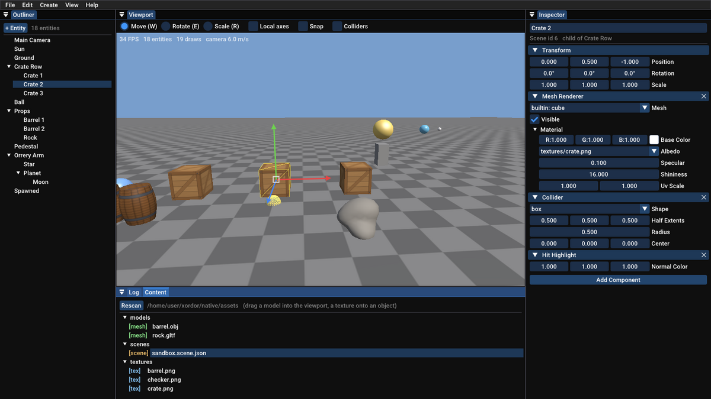

# Phase 5: The editor

**Status: done.** It builds, the tests pass, and the editor runs (checked on Linux with Mesa's software OpenGL driver: GCC 13 Debug and Clang Release builds with warnings as errors, a GCC build under AddressSanitizer and UndefinedBehaviorSanitizer, all 16 test suites with 145 unit tests and 9 GPU tests, and the editor driven with real mouse and keyboard input, under the sanitizers too, through gizmo moves, rotations and scales, click selection, delete, outliner drag-and-drop, inspector edits, dropping a model from the content browser, undo and save, each checked against the saved scene file).



## Plan

**Goal:** a standalone editor for building scenes: dockable panels, a 3D viewport with gizmos, a hierarchy tree, an inspector generated from the component data, a content browser, and undo / redo for every change.

| Piece | File | What it does |
|---|---|---|
| Editor app | `editor/EditorApp.h/.cpp`, `main.cpp` | Dear ImGui setup, docked layout, menus, shortcuts, open / save, "unsaved changes?" |
| Viewport | `editor/ViewportPanel.cpp` | Scene drawn into a texture through the editor's own camera; fly, click to select, gizmo, drop assets |
| Gizmo | `editor/Gizmo.h/.cpp` | Move / rotate / scale handles, written from scratch on top of tested ray math |
| Outliner | `editor/OutlinerPanel.cpp` | The hierarchy; drag onto an entity to parent it, below the tree to unparent |
| Inspector | `editor/InspectorPanel.cpp`, `FieldHints.h/.cpp` | Fields generated from each component's JSON, plus hints (colors, choices, asset slots) |
| Content browser | `editor/ContentPanel.cpp` | Assets by folder; drag into the viewport or onto inspector slots |
| Log | `editor/LogPanel.cpp` | Engine log messages inside the editor |
| Undo / redo | `editor/Commands.h/.cpp` | `UndoStack` and commands: change component, rename, create, delete, reparent, duplicate |
| Offscreen target | `render/Framebuffer.h/.cpp` | A color texture + depth buffer to draw the viewport into |
| Ray math | `core/Geometry.h/.cpp` | Rays from the screen, ray vs box / sphere / plane, closest point on an axis, signed angles |
| Picking | `scene/SceneRenderer` | `pickEntity`, selection box, icons for cameras / lights / empty entities, `renderView` |
| Stable ids | `scene/Scene.h/.cpp` | `SceneId`: an entity's number for life, kept through save, load, delete and undo |
| Serializer | `assets/SceneSerializer` | Per-component and per-subtree JSON; unknown components kept, not dropped |
| Tests | `tests/editor_tests.cpp`, geometry, serializer | Undo stack, every command, gizmo math, field hints, ray math |

**Library:** Dear ImGui (docking branch, v1.91.5), the standard choice for engine tools. **Gizmos are our own** rather than ImGuizmo. The math is the same ray math the viewport needs for clicking on objects, so writing it once (and testing it) teaches more than adding a library, and avoids matching ImGuizmo to an ImGui version.

## Files that changed

```
native/
├── CMakeLists.txt  cmake/Dependencies.cmake   + XE_BUILD_EDITOR option, Dear ImGui (+ GLFW / OpenGL 3 backends)
├── .gitignore                                 + editor_layout.ini
├── docs/phase-5.md, images/                   new
├── src/editor/                                new module
│   ├── EditorApp.h/.cpp  main.cpp  CMakeLists.txt
│   ├── ViewportPanel.cpp  OutlinerPanel.cpp  InspectorPanel.cpp  ContentPanel.cpp  LogPanel.cpp
│   ├── Gizmo.h/.cpp  FieldHints.h/.cpp
│   └── Commands.h/.cpp
├── src/core/Geometry.h/.cpp                   + Ray, rayFromScreen, intersect, closestOnLine, signedAngle
├── src/core/Window.h/.cpp                     + glfwHandle() for ImGui, cancelClose()
├── src/render/Framebuffer.h/.cpp              new
├── src/render/Mesh.h/.cpp                     + bounds()
├── src/scene/Scene.h/.cpp                     + SceneId (idOf, findById, createEntityWithId, reserveId), sibling order
├── src/scene/SceneRenderer.h/.cpp             + renderView, pickEntity, pickBounds, icons, selection box
├── src/assets/SceneSerializer.h/.cpp          + component / subtree API, UnregisteredComponents, ids = SceneIds
├── src/assets/JsonUtil.h/.cpp                 + readUInt64
└── tests/editor_tests.cpp (new), geometry_tests.cpp, serializer_tests.cpp, CMakeLists.txt
```

## Build and run

Same as before. The first configure also clones Dear ImGui. To build without the editor, configure with `-DXE_BUILD_EDITOR=OFF`.

| | Commands |
|---|---|
| Windows (Developer PowerShell for VS 2022) | `cmake -S . -B build` · `cmake --build build --config Debug` · `.\build\bin\Debug\editor.exe` |
| macOS | `cmake -S . -B build` · `cmake --build build` · `./build/bin/editor` |
| Linux | `cmake -S . -B build` · `cmake --build build -j` · `./build/bin/editor` |

`editor` opens `assets/scenes/sandbox.scene.json`; `editor scenes/other.scene.json` opens another. For checks and screenshots there are `--select NAME`, `--gizmo move|rotate|scale` and `--frames N --screenshot out.png`. The panel layout is saved to `editor_layout.ini` in the folder you start it from; delete that file (or use View > Reset Panel Layout) to get the default back.

### Editor controls

| Where | Input | Does |
|---|---|---|
| Viewport | Right mouse + move, WASD, Q / E, Shift, scroll | Fly the editor camera |
| | Left click | Select (click empty sky to deselect) |
| | W / E / R | Move / rotate / scale gizmo |
| | Drag a handle; hold Ctrl | Change the selection; snap (0.5 m, 15°, 0.1) |
| | F | Focus on the selection |
| | Drop a model / texture / scene | New entity there / paint the object / open the scene |
| Outliner | Click, drag onto, drag below, right click | Select, parent, unparent, create / duplicate / delete |
| Inspector | Edit any field; × on a header; Add Component | Change, remove, add components |
| Anywhere | Ctrl+Z, Ctrl+Y (or Ctrl+Shift+Z) | Undo, redo |
| | Ctrl+S, Ctrl+D, Delete, Ctrl+N | Save, duplicate, delete, new scene |

## How it works

### 1. Immediate-mode UI

Dear ImGui has no widget objects. Every frame the editor calls `ImGui::Button("Save")`, `ImGui::DragFloat3("Position", v)` and so on, and each call draws the widget *and* returns whether the user changed it this frame. The UI is a function of the current state, so there's no second copy to keep in sync. If the scene changes (undo, load), next frame's UI simply shows it. Panels are windows docked into a dockspace; ImGui's `DockBuilder` sets up the default layout on first run, and ImGui saves whatever you rearrange.

```
every frame:  NewFrame → menu bar → dockspace → Viewport → Outliner → Inspector → Log → Content
              → popups → shortcuts → commit live edits → run deferred actions → Render
```

**Deferred actions.** Deleting or reparenting an entity while the outliner is walking the tree would change the list being walked. UI code therefore queues such changes (`deferred_`), and they run after all panels are drawn.

### 2. The viewport is a texture

```
Framebuffer (color texture + depth)  ◄── SceneRenderer::renderView(scene, editor camera)
        │
        ▼
ImGui::Image(texture, panel size, uv flipped)   ← OpenGL's row 0 is the bottom, ImGui's the top
        │
        ▼
Gizmo and overlay text drawn on top with ImGui's draw list
```

Each frame the framebuffer is resized to the panel, so the viewport is just another dockable window. The editor camera is a plain `Camera`, not an entity, so flying around never changes the scene or the undo history. Cameras, lights and empty entities have nothing to draw, so they get small wire-sphere icons, which makes them visible and clickable. The selection gets a yellow box.

### 3. From the mouse to the 3D world: rays

```
mouse pixel ──► NDC (-1..1) ──► inverse(projection × view) at depth -1 and +1 ──► two points ──► Ray
```

- **Clicking:** the ray is tested against each entity's world box (mesh bounds through `transformAabb`), and the nearest hit wins. Boxes the ray *starts inside* are skipped. The editor camera often sits right on the scene's camera icon, and testing found that it selected that icon on every click.
- **Dropping a model:** where the ray meets the ground plane (y = 0).
- **Gizmo, move along an axis:** the mouse ray and the axis line almost never meet, so the gizmo uses the point on the axis *closest* to the ray (`closestOnLine`). The distance moved is that point now minus that point when the drag began.
- **Gizmo, rotate:** intersect the ray with the ring's plane at the start and now; the turn is the signed angle between the two hits around the axis.
- **Gizmo, scale:** the ratio of the two closest-point distances from the center.

Each frame the result is computed from the drag's *start*, never by adding small per-frame steps, so rounding can't pile up and snapping applies to the total. The gizmo works on the world matrix. The editor converts the result back to the entity's local transform with `inverse(parentWorld) × world`, then `decomposeTRS`, as reparenting does. Its handles are a fixed number of pixels long whatever the distance: `metersPerPixel` comes from the projection matrix's `[1][1]` entry, which is `1/tan(fov/2)`.

### 4. A generated inspector

```
component ──serializer.saveComponent──► JSON ──► one widget per field ──► edited JSON ──serializer.loadComponent──► component
```

The inspector has no per-component code. It draws widgets from the JSON's types (number → drag box, `[x, y, z]` → three boxes, `true` → checkbox, `{id, path}` → asset slot), and `FieldHints` adds what types can't say: `baseColor` is a color, `shape` is box or sphere, `albedo` takes textures. Every component the serializer knows gets an inspector, including an app's own, and what you edit is exactly what gets saved. Components no serializer was registered for (the sandbox's `Spin` and `Patrol` when opened in the editor) are kept as plain JSON (`UnregisteredComponents`), so they appear, can be edited, and are written back on save instead of being lost.

### 5. Undo and redo: commands, JSON and stable ids

```
UndoStack:  [Edit Transform of Crate 2] [Delete Crate 3] [Create barrel] ^ (redo side)
```

Every change is a `Command` with `apply()` and `revert()`. Most store their data as JSON from the serializer, so a handful of command types cover everything:

| Command | Stores | Undo |
|---|---|---|
| `ChangeComponentCommand` | component JSON before and after (null = absent) | load "before" |
| `DeleteEntityCommand` | the subtree as JSON, parent, sibling index | recreate it with the same ids, same place |
| `CreateEntitiesCommand` | the new subtree as JSON (ids fixed when built) | destroy it |
| `ReparentCommand` | old parent, index and exact local transform | put it all back |
| `RenameCommand` | old and new name | old name |

Two details make this work:

- **Stable ids.** Commands store `SceneId`s, never `Entity` handles. Undoing a delete recreates the entity with a new handle but the same `SceneId`, so older commands in the history still find it. The scene file's `"id"` is now that same number. A test renames an entity, deletes it, then undoes both.
- **Live edits as one step.** Dragging a value or a gizmo changes the scene every frame, but undo should be one step. The first change remembers the component (`noteEdit`), changes apply live, and when nothing is being dragged any more `commitEdit` pushes one command with the before and after JSON. The gizmo isn't an ImGui widget, so it must be asked separately. Testing found exactly that bug: the drag was committed, empty, on its first frame.

The stack also tracks the **saved position**, so "unsaved changes" is just "not at the saved position". Undo back to it and the `*` in the title disappears.

### 6. How it was tested

The editor's logic (commands, gizmo math, hints) is unit-tested without a window. The UI itself was driven with real X input (xdotool) under a virtual display. Each script presses keys, drags gizmos, then saves, and checks the *saved scene file*. The Phase 4 serializer turned that into an easy and exact way to check results. One lesson: synthetic key taps of 12 ms can fall entirely within one frame at the software renderer's ~30 fps and get missed, so the scripts hold keys for ~100 ms, as a person does.

## Exercises

1. **Multi-selection.** Change `EditorDocument::selected` into a list. Ctrl+click adds to it in the viewport and outliner, the gizmo moves all selected entities by the same world delta, and Delete removes them all in *one* undo step. Write a small `CompositeCommand` holding several commands, applied in order and reverted in reverse. Why reverse?
2. **Copy and paste.** Ctrl+C stores `saveEntityTree` JSON for the selection on the clipboard (`ImGui::SetClipboardText`); Ctrl+V loads it with fresh ids under the selected entity. Paste into a second editor window, or into a text editor to read it. What has to happen to the ids, and why can't paste reuse them?
3. **A better pick.** `pickEntity` tests boxes, so clicking the empty corner of a rotated barrel's box still selects it. Make picking exact: after the box test, test the mesh's triangles (Möller–Trumbore ray-triangle) for the nearest few candidates. Where do you get the triangles, given the mesh's vertex data lives on the GPU? (Hint: keep a CPU copy for meshes that can be picked, and think about the memory cost.)

## Known limitations and what comes next

- **No play mode yet.** The editor edits; it doesn't run gameplay (Spin and Patrol don't move here). Phase 6 adds Play / Stop, copying the scene when play starts and restoring it on stop.
- **Single selection.** One entity at a time (exercise 1).
- **Box picking.** Clicks test bounding boxes, not triangles (exercise 3; TODO in `SceneRenderer.h`).
- **No asset thumbnails, import settings UI or file operations** (rename, move) in the content browser. Edit `.meta` files by hand for now.
- **Undo history is limited to 500 steps** and measured in commands, not bytes (TODO in `Commands.h`).
- **One viewport, no orthographic views or grid.** The checkerboard floor stands in for a grid.
- **Keyboard shortcuts rely on ImGui's key state.** Taps shorter than a frame can be missed at very low frame rates, which only shows up with synthetic input.
- Tested on Linux with Mesa only. The Windows and macOS commands follow the same CMake flow but weren't run here; on HiDPI screens the UI may look small (no DPI scaling yet).

**Next: Phase 6, gameplay.** Lua scripting through sol2, with script components the inspector can show, hot-reloaded scripts, a player controller, collision response (pushing objects apart), an event system (collision enter / exit, triggers), and Play / Stop in the editor.
